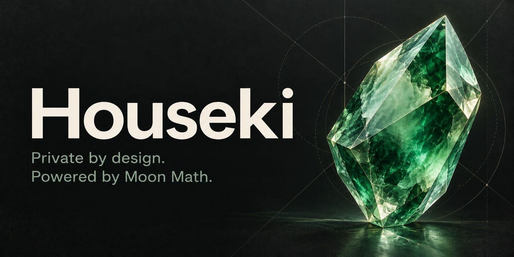

<p align="center">
  
</p>

<p align="center">
  <a href="https://github.com/thilapia/houseki/actions/workflows/native-x86.yml"></a>
  <a href="https://github.com/thilapia/houseki/actions/workflows/proofs-adversarial.yml"></a>
  <a href="https://github.com/thilapia/houseki/actions/workflows/proofs-platforms.yml"></a>
  <br>
  <a href="Cargo.toml"></a>
  <a href="#status"></a>
  <a href="UNLICENSE"></a>
</p>

# Houseki

**Private by design. Powered by Moon Math.**

Houseki is an experimental Rust project building the foundations of a private payment system. It brings together
encrypted notes, authenticated note state, and local zk-STARK proving and verification through small, focused crates.

[Get started](#get-started) · [Explore the crates](#workspace) · [Proof documentation](crates/houseki-proofs/README.md) ·
[Status](#status)

> [!IMPORTANT]
> Research software. Proof profiles are experimental and have not received independent cryptographic review.
> Production profile admission remains closed. The validator is currently a scaffold.

## What works today

- **Encrypted notes.** Commitments, position-bound nullifiers, recipient descriptors, encrypted delivery and
  authenticated recovery.
- **Local proofs.** Payments with one through four real inputs and one or two outputs, plus reward withdrawals with
  one output. Fees remain separate from note outputs.
- **Public verification.** A verifier without witness owners or proving entropy, bounded proof decoding and a single
  combined proving or verification slot per runtime.
- **Protected proving.** Native secret owners, guarded temporary allocations and cooperative cancellation. The Android
  harness exercises foreground interruption and fresh attempts after resumption.
- **Reproducible validation.** Public conformance vectors, adversarial mutation campaigns, external consumers and
  cross-platform proof exchange tooling.

Native cryptography includes ML-KEM-1024, ML-DSA-87, AES-256-GCM-SIV, HKDF-SHA-512 and Poseidon2. The proof backend uses
Plonky3 with AIR and FRI. These are implementation choices, not a security claim for the unfinished system.

## Workspace

| Crate | Responsibility |
| --- | --- |
| [`houseki-types`](crates/houseki-types) | Checked amounts, identifiers, transaction bodies, envelopes and canonical encodings. |
| [`houseki-crypto`](crates/houseki-crypto) | Native keys, signatures, encryption, hashes and note-tree hashing. |
| [`houseki-state`](crates/houseki-state) | Append-only note trees and protected membership witnesses. |
| [`houseki-notes`](crates/houseki-notes) | Note openings, delivery, recovery, nullifiers and native relation checks. |
| [`houseki-proofs`](crates/houseki-proofs) | Experimental payment and withdrawal proving, verification and bounded proof codecs. |
| [`houseki-validator`](crates/houseki-validator) | Validator scaffold for future execution and consensus work. |

The [adversarial harness](crates/houseki-proofs/fuzz/README.md) and
[qualification harness](crates/houseki-proofs/qualification/README.md) are separate workspaces with their own lockfiles.
Retained backend patches live under [`vendor/plonky3`](vendor/plonky3).

## Get started

Build from source with Rust **1.99.1**. Workspace packages are not published to crates.io.

```sh
git clone https://github.com/thilapia/houseki.git
cd houseki
rustup toolchain install 1.99.1 --profile minimal --component clippy --component rustfmt
```

Generate a real withdrawal proof with synthetic data, then verify its public artifacts with the default consumer.
The producer creates a new directory. Only public body and proof bytes are retained there.

```sh
artifact_dir="$(mktemp -d)/withdrawal"

cargo +1.99.1 run --manifest-path crates/houseki-proofs/qualification/Cargo.toml \
  --release --locked --features prover -- produce withdrawal "$artifact_dir" 1

cargo +1.99.1 run --manifest-path crates/houseki-proofs/qualification/Cargo.toml \
  --release --locked -- verify withdrawal "$artifact_dir/sample-0000" 1
```

For a payment, use `payment-4-2` in both commands. All eight combinations from `payment-1-1` through `payment-4-2` are
supported. Larger shapes take more time and memory. JSON output reports timings and encoded sizes.

The [complete payment example](crates/houseki-proofs/examples/payment/main.rs) also exercises authenticated delivery,
recovery, tree append and spending recovered notes. The
[withdrawal example](crates/houseki-proofs/examples/reward_withdrawal/main.rs) includes the separate source-signature
check. See the [proof API guide](crates/houseki-proofs/README.md) for feature flags, ownership and consumer obligations.

## Checks

The full release suite enables every feature and runs serially. It includes real proofs and can take several minutes.

```sh
cargo +1.99.1 fmt --all --check
cargo +1.99.1 test --workspace --release --all-features --locked -- --test-threads=1
cargo +1.99.1 clippy --workspace --all-targets --all-features --locked -- \
  -D warnings -D missing_docs -D clippy::missing_docs_in_private_items
```

The standalone harnesses have their own commands for
[conformance and mutation testing](crates/houseki-proofs/fuzz/README.md) and
[native measurements, Android lifecycle checks and proof exchange](crates/houseki-proofs/qualification/README.md).
CI badges above link to the actual workflows.

## Status

The first-release target scope is **Apple Silicon macOS, Linux x86-64 and Android ARM64**. Windows and iOS are deferred.
Available M4 and Redmi engineering runs cover every supported workload, including proof exchange in both directions.
That evidence does not complete reference-device, power, thermal or statistical performance qualification.

Independent cryptographic review, composed security analysis and production profile freeze remain open. Larger mobile
workloads miss the soft proving target. The [release policy](crates/houseki-proofs/release-policy.json) records the
candidate's constraints and readiness gates.

A verified payment proof still requires external anchor eligibility, unspentness, fee policy and atomic state updates.
A verified withdrawal output proof still requires source authorization and account-state checks. Consensus, ledger
execution and a complete transaction wire format remain separate work. This repository does not yet provide a running
payment network or wallet application.

## License

Houseki is released under the [Unlicense](UNLICENSE). Vendored dependencies retain their own
[MIT](vendor/plonky3/LICENSE-MIT) and [Apache 2.0](vendor/plonky3/LICENSE-APACHE) notices.
